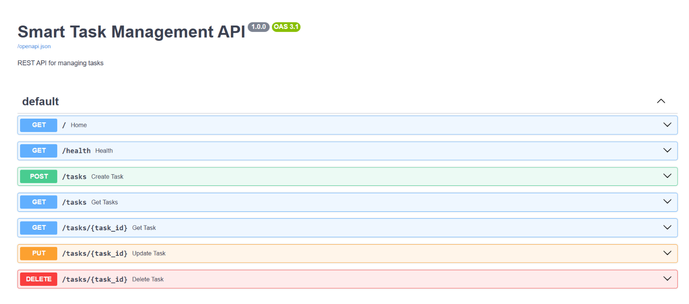

# Smart Task Management API

A RESTful API built with Python, FastAPI, SQLAlchemy, and SQLite to manage tasks efficiently.

## Features
- Create new tasks
- View all tasks
- Get a task by ID
- Update task details
- Delete tasks
- Store task information in a database
- Health check endpoint
- Interactive API documentation with Swagger UI

## Tech Stack
- Python
- FastAPI
- SQLAlchemy
- SQLite
- Pydantic

## Project Structure
```text
smart-task-management-api/
├── app/
│   ├── __init__.py
│   ├── main.py
│   ├── database.py
│   ├── models.py
│   └── schemas.py
├── requirements.txt
└── README.md
├── test_main.py
```

## Setup Instructions

### 1. Clone the repository
```bash
git clone https://github.com/aditilondhe17/smart-task-management-api.git
cd smart-task-management-api
```

### 2. Create a virtual environment
```bash
python -m venv .venv
```

Activate on Windows:
```bash
.venv\Scripts\activate
```

### 3. Install dependencies
```bash
pip install -r requirements.txt
```

### 4. Run the API
```bash
uvicorn app.main:app --reload
```

### 5. Open API documentation
Visit:
http://127.0.0.1:8000/docs

## API Endpoints

| Method | Endpoint | Description |
|---|---|---|
| GET | `/` | Welcome message |
| GET | `/health` | Health check |
| POST | `/tasks` | Create a task |
| GET | `/tasks` | List tasks |
| GET | `/tasks/{task_id}` | Get one task |
| PUT | `/tasks/{task_id}` | Update a task |
| DELETE | `/tasks/{task_id}` | Delete a task |

## Learning Outcomes
- REST API development
- CRUD operations
- Database integration using SQLAlchemy
- Request validation with Pydantic
- API testing through Swagger UI

  ## Project Screenshot



## Testing

Automated API tests are written using Pytest and FastAPI's TestClient.

Run the tests with:

```bash
python -m pytest test_main.py -v
```

**Test Results:** 4 tests passed.

## Future Improvements

- Add user authentication and authorization
- Add task status and priority filters
- Add pagination and improved error handling
- Deploy the API to a cloud platform
